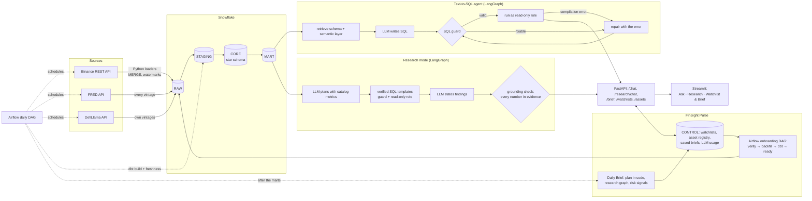

# FinSight AI

[](https://github.com/dt-thanh/TEXT-TO_SQL/actions/workflows/ci.yml)

Ask questions about crypto markets, the US macro backdrop and DeFi in plain English or
Vietnamese, and get an answer computed in Snowflake, **together with the SQL that produced it**.
Research questions get a short report whose every number is traced to verified SQL.

> *"What was Ethereum's annualized volatility in 2025 on days when the 10-year Treasury yield
> rose from the previous day?"* → SQL on curated marts → a number, a chart, the table, and the
> query, explained step by step.

The project has four parts, built to production habits rather than demo shortcuts:

- **A data platform.** Binance (hourly candles for BTC, ETH, SOL, BNB since 2019), FRED (Fed
  Funds rate, 10-year Treasury yield and CPI, with every revision) and DefiLlama (daily DeFi TVL of each
  asset's chain and of all chains) are loaded idempotently into Snowflake, modeled with dbt into
  point-in-time correct marts, and refreshed daily by Airflow.
- **A Text-to-SQL agent (Quick SQL), as a chat.** A LangGraph workflow writes SQL with an LLM,
  checks it with a sqlglot-based guard, runs it as a read-only Snowflake role, and repairs its
  own mistakes a bounded number of times. Follow-ups ("and ETH?") are rewritten into standalone
  questions, and the rewrite is shown. Greetings and requests for investment advice are answered
  by rules, with no LLM call and no SQL.
- **A research mode.** For multi-step questions the model only plans with a catalog of verified
  metrics; code writes the SQL from templates; the model states findings; code checks every
  number against the evidence. FastAPI and a Streamlit screen serve both modes.
- **FinSight Pulse.** Watchlists of coins the owner picks: any USDT pair Binance trades. A typed
  coin is checked against the exchange and a typo gets "did you mean". Its history is backfilled
  by Airflow with the same loaders. Risk signals are computed by fixed, tested rules in dbt.
  Every morning a Daily Brief is built from verified SQL, with the same grounding check. One
  owner, no accounts; endpoints bound to localhost or behind a service key, and a daily LLM cost
  cap ([docs/pulse.md](docs/pulse.md), [docs/operations.md](docs/operations.md)).

## Results

Measured on 2026-10-26 with `gpt-4.1-mini`, after the Pulse changes, graded by comparing
**results**, not SQL text. Holdout questions were committed before the agent answered them and
are never used to tune anything.

| Quick SQL (`make eval`, 35 questions) | Value |
|---|---|
| Execution accuracy, all questions | 35/35 (95% CI 90–100%) |
| Holdout questions | 16/16 (95% CI 81–100%) |
| Generated SQL that passed the guard and ran | 31/31 |
| Latency per question, as the user waits | p50 1.9 s, p95 3.3 s |
| LLM cost per question | ~$0.0019 |

| Research mode (`make eval-research`, 21 questions) | Value |
|---|---|
| Questions answered correctly (right metrics, right values, grounded) | 21/21 (95% CI 85–100%) |
| Holdout questions | 11/11 (95% CI 74–100%) |
| Expected results reproduced exactly | 27/27 |
| Must-decline questions declined (stocks, raw tables, stablecoins, forecasts) | 4/4 |
| Latency per question | p50 2.4 s, p95 3.4 s |
| LLM cost per question | ~$0.0019 |

| Chat (`make eval-chat`, 10 conversations, last turn graded) | Value |
|---|---|
| Follow-ups answered with the right result, greetings and out-of-scope handled | 10/10 (holdout 7/7, 95% CI 65–100%) |
| Cost for the 10 conversations (19 turns) | $0.033 |

| Daily Brief (`make eval-brief`, 4 cases, answers computed independently) | Value |
|---|---|
| Plan, period, every return and drawdown, every risk signal, findings grounded | 4/4 (holdout 2/2) |
| Findings dropped by the number check | 0 of 26 |
| Latency, cost per brief | p50 4.3 s, p95 9.1 s; ~$0.003 |

Tests: 487 Python tests (413 unit, 74 integration on Snowflake and the live APIs, DAG integrity),
123 dbt data tests and 4 dbt unit tests for the risk rules, CI on every push. A perfect score on a few dozen questions is not a perfect system: the
intervals above are the honest reading.

The benchmarks are small and the confidence intervals say so. Model choice and prompt changes are
compared with repeated runs (see [Engineering notes](#engineering-notes)).

## Architecture



| Layer | What it does | Where |
|---|---|---|
| Ingestion | Idempotent MERGE loads, per-source watermarks, month-by-month backfill that survives crashes, retries with backoff, a revision history for DefiLlama built from daily fetches | [src/ingestion/](src/ingestion/) |
| Warehouse | RAW → STAGING → CORE → MART with dbt; point-in-time macro join; known-answer and freshness tests | [dbt/](dbt/) |
| Orchestration | Airflow 3 in Docker; loads → freshness check → dbt layer by layer → daily brief; on-demand asset onboarding sharing pools with the daily run | [airflow/](airflow/) |
| Pulse | Asset universe (any USDT pair Binance trades, typed and checked), watchlists, risk signals by rule in dbt, Daily Brief, single-owner protections (localhost or a service key, rate limits, daily LLM cost cap) | [src/control/](src/control/), [docs/pulse.md](docs/pulse.md) |
| Agent | Quick SQL: retrieve context → generate → validate → execute → repair. Research: plan → execute templates → write → grounding check | [src/agents/](src/agents/) |
| Semantic layer | Metric definitions with SQL templates and golden cases, glossary, verified example queries, all in YAML | [semantic/](semantic/) |
| Safety | AST-based SQL guard + least-privilege Snowflake role + timeouts | [src/services/sql_guard.py](src/services/sql_guard.py), [infra/snowflake/](infra/snowflake/) |
| Serving | FastAPI contract, Streamlit thin client (no secrets in the UI) with chat tabs, VI/EN, request ids in responses, logs and Snowflake query tags | [src/api/](src/api/), [ui/](ui/) |
| Evaluation | Execution accuracy and a research benchmark (metric selection, values, grounding, refusal), dev/holdout, Wilson intervals | [eval/](eval/) |

More detail: [docs/architecture.md](docs/architecture.md) (both graphs, error taxonomy, boundaries).

## Key design decisions

**Point-in-time macro data.** FRED revises its numbers. RAW keeps every published version
(vintage), and the mart joins each trading day only to the value that had already been
published that day, so an analysis of "days when yields rose" cannot use information from the
future. A dbt test checks it on known dates (Friday's 10-year yield is only known on Monday).

**The LLM is untrusted.** Its SQL is parsed into a syntax tree with sqlglot and must be exactly
one read-only query on allowlisted MART tables, with no `SELECT *` and a row cap. What runs is
the query printed back from the checked tree, without comments. Behind the guard, the agent's
Snowflake role can only `SELECT` from MART, and statements time out after 30 s.

**Repair only what can be repaired.** A compilation error (unknown column) or a fixable guard
violation goes back to the model with the failed SQL, at most twice. An attempt to write data,
a timeout or a lost connection ends the run: retrying those only costs money or teaches the
model to get around the guard.

**No silent wrong answers.** Results with two columns of the same name are refused (a dict would
drop one), a `LIMIT` without `ORDER BY` in the same SELECT is refused (it returns arbitrary
rows), and every answer states the newest day the data covers. Stale sources fail the Airflow
run instead of producing outdated answers.

**Semantic layer as reviewed data.** Formulas that no single column holds (volatility of a period,
compounded return, moving averages) live in YAML with English and Vietnamese synonyms and known
pitfalls, validated on load and checked against the warehouse by integration tests. Retrieval is
lexical on purpose: with a dozen concepts it is free, deterministic and easy to debug.

**Research numbers never come from the model.** In research mode the model chooses metrics and
parameters from a catalog (its answer is a strict JSON schema whose metric id is an enum). Code
checks every parameter (known symbols and chains, dates within the data, numbers in range) and
fills a verified SQL template; the result still passes the guard and the read-only role. The
model then phrases findings, and a grounding check in plain code rejects any number that is not
in the evidence it cites (percent vs fraction, basis points, "billion"/"tỷ", English and
Vietnamese number formats). Caveats that follow from the data, such as a 10-year yield FRED
stopped publishing or retrospective TVL, are added by code.

**Inflation as it was known.** CPI is published two weeks after each month and revised later.
`mart_cpi_monthly` keeps every month as first published and computes its month-over-month and
year-over-year change from the base months as they were known on the release day; each calendar
day carries the newest month already published.

**A revision history the source does not publish.** DefiLlama recomputes past TVL and keeps no
vintages. Each daily load stores a value only when it is new or differs from the newest stored
one, with the fetch day in the grain, so "what did DefiLlama say on day X" stays answerable from
the day the pipeline started; earlier history is marked retrospective.

**No technology without a problem.** No vector database, no message queue, no Kubernetes: the
data volume and the number of concepts do not need them. Each tool in the stack answers a
specific need listed above.

## Engineering notes

A few things that were measured rather than assumed:

- **Latency.** A key-pair login to Snowflake costs ~2.3 s, and each question used to open two
  connections and re-read the schema: users waited 9–10 s. One kept connection per process and a
  10-minute schema cache brought the Snowflake part to ~0.1 s per question.
- **A prompt regression caught by A/B.** Adding three "harmless" rules to the system prompt
  dropped holdout accuracy from 26/27 to 20/27 over three runs each. An ablation isolated the
  cause, the rules were reverted, and the questions used to decide moved from holdout to dev.
- **Holdout discipline.** A question used to decide a change leaves the holdout split, so the
  holdout score stays an estimate for questions nobody tuned for. New benchmark questions are
  committed before the agent answers any of them.
- **A dependency upgrade that would have opened a hole.** sqlglot 30 renamed the FROM argument of
  its syntax tree; the guard silently stopped seeing `TABLE(...)` sources until a unit test
  failed. The guard now checks every FROM/JOIN node rather than argument names.
- **Choosing the model by measurement.** gpt-4o-mini, gpt-4.1-mini and gpt-5-mini, three runs
  each on the same questions: gpt-4.1-mini matched the best accuracy, gave the same answers on
  every run and cut p95 latency from 10–15 s to about 3 s, for about twice the price.
- **A maintenance page served with HTTP 200.** FRED answered every request with an HTML page;
  the loader now retries a non-JSON 200 like a 5xx and fails with a clear error, and the
  freshness check turned the stale FRED data red instead of serving it silently.

## Tech stack

Python 3.11 · Snowflake · dbt 1.12 · Apache Airflow 3.3 · LangGraph 1.2 · OpenAI (`gpt-4.1-mini`,
Structured Outputs) · sqlglot · FastAPI · Streamlit · Docker Compose · pytest · GitHub Actions

## Getting started

Requirements: Python 3.11, a Snowflake account, a FRED API key, an OpenAI API key, and Docker for
Airflow and the containerised app.

```bash
python3.11 -m venv .venv && source .venv/bin/activate
make install                 # runtime + dev dependencies
cp .env.example .env         # then fill it in (see below)
make test-unit               # offline tests, no credentials needed
```

**Snowflake.** Create a key pair outside the repository (`~/.snowflake/`), run
[infra/snowflake/00_setup.sql](infra/snowflake/00_setup.sql) (warehouse, database, schemas, roles,
service user, resource monitor), [01_raw_tables.sql](infra/snowflake/01_raw_tables.sql) and
[02_agent_user.sql](infra/snowflake/02_agent_user.sql) (the read-only agent user),
[03_control_access.sql](infra/snowflake/03_control_access.sql) (the CONTROL schema and the API's
own user) and [04_control_tables.sql](infra/snowflake/04_control_tables.sql), register the public
keys, and fill `SNOWFLAKE_*` in `.env`. `make check-snowflake` confirms the connection. Step by
step: [docs/operations.md](docs/operations.md).

**Load and model the data.**

```bash
make load-binance    # first run backfills 2019 → now (~257k candles), later runs are incremental
make load-fred       # every FRED vintage since 2018-12
make load-defillama  # DeFi TVL per chain; the first run is a backfill
make dbt-deps && make dbt-build
```

**Ask questions.**

```bash
make ask Q="Which asset had the highest 30-day volatility on 2026-09-01?"
make research Q="When Ethereum TVL fell more than 10% in a week, was ETH more volatile?"
make refresh-binance-catalog        # the USDT pairs Binance trades (Airflow does it daily)
make add-asset SYMBOL="link avax"   # check coins, onboard the right ones
make run             # API on http://127.0.0.1:8000/docs
make ui              # in a second terminal: http://127.0.0.1:8501 (busy port: make ui UI_PORT=8502)
```

## Commands

| Command | Purpose |
|---|---|
| `make ci` | Lint, unit tests and `dbt parse`: the checks CI runs, before you push |
| `make test` | All tests; integration tests run when Snowflake is configured |
| `make load-binance` / `make load-fred` / `make load-defillama` | Incremental loads into RAW |
| `make dbt-build` / `make dbt-freshness` | Build and test the models / check source freshness |
| `make airflow-up` | Airflow in Docker, UI on :8081, daily run at 00:30 UTC |
| `make ask Q="..."` / `make research Q="..."` | One question (Quick SQL) or a research report from the terminal |
| `make prompt Q="..."` | Print exactly what the model would read, without calling it |
| `make eval` / `make eval-research` | Quick SQL and research benchmarks (~$0.07 and ~$0.04 per full run; `ARGS="--gold-only"` is free) |
| `make eval-chat` / `make eval-brief` | Conversation and Daily Brief benchmarks (~$0.03 and ~$0.01; `eval-brief ARGS="--no-llm"` is free) |
| `make add-asset SYMBOL="..."` / `make onboard-assets` | Check and request coins / run onboarding by hand without Airflow |
| `make brief ARGS="--watchlist default --print"` | Make and save a Daily Brief (`--no-llm` costs nothing) |
| `make risk-frequency` | How often each risk rule fires on real data |
| `make run` / `make ui` / `make app-up` | API, UI, or both in Docker |

## Repository layout

```text
src/ingestion/   Binance, FRED and DefiLlama clients, loaders, sync logic (watermarks, backfill)
dbt/             STAGING, CORE, MART models, seeds, data tests
airflow/         Airflow image, compose file and the daily DAG
src/agents/      Quick SQL graph, nodes, prompts; research/ (catalog resolver, grounding, report)
src/semantic/    semantic layer loading and retrieval   (data in semantic/)
src/services/    Snowflake client, LLM client, SQL guard, chart selection
src/control/     FinSight Pulse state: asset registry and onboarding, watchlists, briefs, cost cap
src/api/, ui/    FastAPI endpoints (access, rate limits), Streamlit client
deploy/          compose file and Caddyfile for a deployment; scripts/deploy.sh deploys and rolls back
eval/            benchmark questions, grader, runner
tests/           unit (offline), integration (Snowflake, APIs), dags (needs Airflow)
infra/snowflake/ one-off SQL to create warehouse, roles and users
```

## Limitations and next steps

- The benchmarks are small (35 Quick SQL and 21 research questions); the confidence intervals
  say so, and a larger holdout set written by someone other than the builder is the next step.
- The research grader checks metrics, values and grounding, not wording: a finding can carry only
  numbers from the evidence and still interpret them loosely. The evidence and its SQL are always
  shown next to the findings for that reason.
- Research answers only what the fourteen catalog metrics compute; other questions are declined
  (or asked in the Ask tab).
- Quick SQL's repair loop fixes compilation errors, not wrong reasoning.
- CPI is monthly and carried forward between releases; October 2025 was never published (US
  government shutdown), so changes that need it are empty rather than estimated.
- One owner, no accounts: the API binds to localhost, or needs one service key when deployed.
  Rate limits and the cost cap live in one process; several API instances would need a shared
  counter.
- Automatic runs need the machine on with Docker running; a missed morning is caught up once
  when Airflow starts. Running 24/7 needs the optional deployment (deploy/, docs/operations.md).
- A coin added later has 365 days of history, not 2019 onwards; DeFi TVL is only mapped to a
  coin through the curated chain list, never guessed from a ticker.
- The product evaluation (manual vs no-LLM vs full Pulse, eval/run_product_eval.py) is ready but
  has not been measured; no time saving is claimed.

## Documentation

- [FINSIGHT_AI_PROJECT_SPEC.md](FINSIGHT_AI_PROJECT_SPEC.md): the full product and data specification.
- [docs/architecture.md](docs/architecture.md): both graphs, error taxonomy, module boundaries.
- [docs/research_copilot.md](docs/research_copilot.md): the Research Copilot upgrade: what changed, results, gaps.
- [docs/pulse.md](docs/pulse.md): FinSight Pulse: what changed, measured results, gap log.
- [docs/operations.md](docs/operations.md): setup, daily use, limits, deploy and rollback, rotating secrets.
- [docs/risk_signals.md](docs/risk_signals.md): the risk rules, their tests and how often they fire.
- [docs/upgrade_baseline.md](docs/upgrade_baseline.md): baseline, dependency upgrade and model A/B.
- [docs/README.vi.md](docs/README.vi.md): detailed setup and operations guide in Vietnamese.
