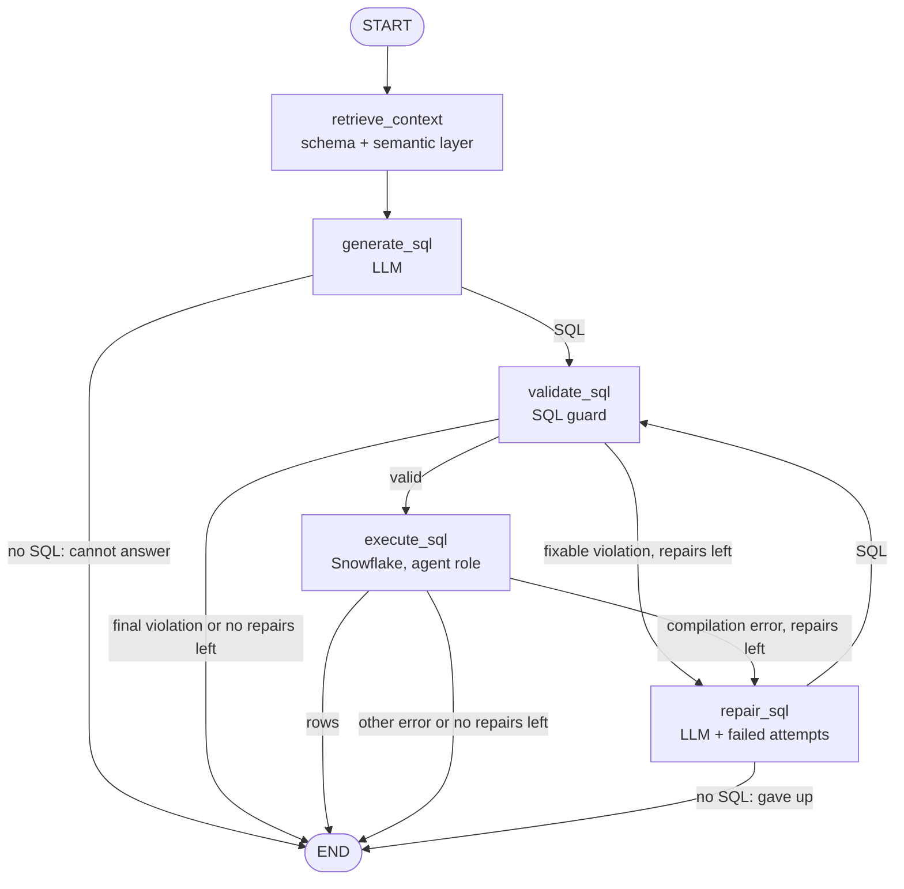
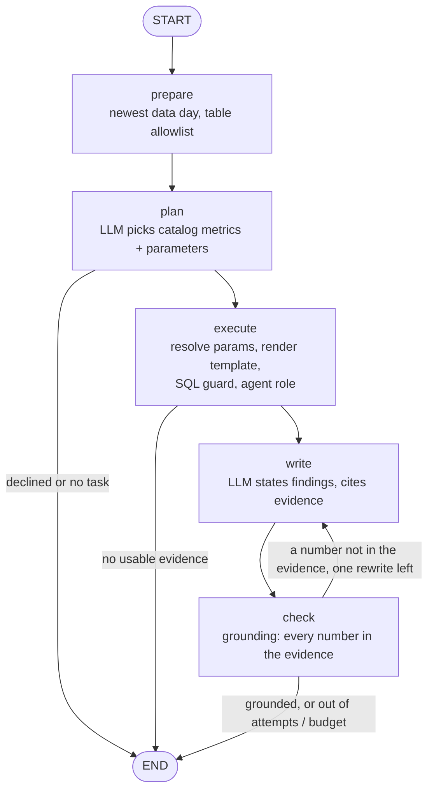

# Architecture

This project separates HTTP transport, LangGraph orchestration, safety policy, and external
adapters so each part can be implemented and tested independently. Four ways in share the same
safety layers:

- **Quick SQL** (`POST /ask`, and `POST /chat` as a conversation): the model writes one SQL query
  from the schema and the semantic layer; a guard checks it; it runs as a read-only role.
- **Research** (`POST /research`, and `POST /research/chat`): the model only plans with a catalog
  of verified metrics; code writes the SQL from templates; the model states findings; code checks
  every number.
- **Daily Brief** (`POST /brief`, and the Airflow task `generate_daily_brief`): the research graph
  with a plan built in code from a watchlist.
- **Conversation** (`src/agents/chat.py`): rules answer greetings and refuse advice or forecasts at
  no cost; the first question goes to Quick SQL or Research unchanged; a follow-up is rewritten into
  a standalone question by the model and the rewrite is shown.

These are **LLM workflows, not autonomous agents**: code fixes the steps, their order and their
limits, and checks every output of the model. The model never chooses a tool or decides when to
stop.

## Text-to-SQL graph (src/agents/graph.py)

## Research graph (src/agents/research/graph.py)

- **Catalog** (`semantic/metrics.yml`): a metric with a `template` has typed parameters, result
  columns with units, the column holding its sample size, a minimum number of observations, a
  point-in-time mode and a golden case verified by an independent calculation.
- **Resolver** (`catalog.py`): the planner's output is untrusted. Symbols and chains must be in the
  coverage, dates within the data, numbers within range; only then are values written into the
  template as SQL literals. The SQL still goes through the guard and runs as the agent role.
- **Grounding** (`grounding.py`): plain code reads every number of a finding (percent, basis
  points, billion/tỷ, English and Vietnamese number formats) and accepts it only if it matches a
  cited result, a sample size, a parameter or a number from the question.
- **Status** is decided by code: complete, partial, insufficient_data, declined, error.
- **Budgets**: 4 tasks, 2 writes, 60 s, $0.01 per question; a brief has 10 tasks, 90 s, $0.02.
- **Daily Brief** (`brief.py`): `build_research_graph(..., planner=code_planner)` replaces the plan
  node; every other node is the same. Multi-row metrics (`symbol_list`, `row_key`) judge each asset
  against `min_observations` on its own. Tables and risk signals are built by code from the
  evidence, so a brief stands when the writer fails, every finding is dropped, or the LLM is off.

## Control plane (src/control, schema CONTROL)

- **Asset universe**: `assets.py` checks typed coins against `CONTROL.BINANCE_SYMBOL` (no Binance
  call during a request) and suggests the pair meant on a typo; `request_asset` writes a
  `requested` row. `onboarding.py` runs in the DAG `finsight_asset_onboarding`: claim with a
  status-guarded `UPDATE`, verify, backfill with the daily loader, dbt build, `ready` once MART has
  rows. The status in the registry is the hand-off between steps; nothing goes through XCom.
- **Watchlists, saved briefs**: `watchlists.py`, `briefs.py`.
- **Daily LLM cost cap**: `usage.py` reserves a request's maximum cost before it runs and records
  the real cost in `CONTROL.API_USAGE`; the API and the scheduled brief share it.
- **Identities**: CONTROL rows go through `FINSIGHT_APP` (API) or `FINSIGHT_ENGINEER` (Airflow);
  market data is read through `FINSIGHT_AGENT` (MART only). LLM-written SQL never has write access.

## Request path (src/main.py, src/api/security.py)

Every request gets an id (`X-Request-ID`, kept if safe, else new) that is on the response, on every
log line (text or JSON) and in each Snowflake `QUERY_TAG` (`finsight_agent:<id>`, `finsight_app:<id>`).
`require_access` is one FastAPI dependency on every router but `/health`: nothing in
`AUTH_MODE=local` (everything listens on 127.0.0.1), one service key compared in constant time in
`AUTH_MODE=deployed` (the app refuses to start without it). Global sliding-window rate limits stop
looping clients. Requests that use the LLM or write CONTROL add a row to `CONTROL.REQUEST_LOG`
from a background thread; both graphs report the seconds spent in each node (`timings`).

## Dependency injection

Nodes are plain functions `node(state, *, dependency)`. `build_graph(llm, warehouse, ...)` and
`build_research_graph(llm, warehouse, layer, planner=None)` bind the LLM client, the warehouse connection and the
limits with `functools.partial`, so tests pass fakes and no node reads a global client.
`answer_question` and `answer_research` build their graph per call and pass an explicit
`recursion_limit` (LangGraph 1.x defaults to 10,007 steps).

## Error taxonomy (Quick SQL)

| Where | Error | Repaired? | Why |
|---|---|---|---|
| SQL guard | `not_select`, `forbidden_statement`, `multiple_statements`, `forbidden_function` | no | an attempt to write or escape; retrying teaches the model to get around the guard |
| SQL guard | `parse_error`, `empty`, `select_star`, `unqualified_table`, `table_not_allowed`, `table_function`, `rewrite_failed` | yes | a mistake in the SQL text |
| SQL guard | `duplicate_column`, `limit_without_order` | yes | SQL that runs but returns a misleading table (a dropped column, arbitrary "top" rows) |
| Snowflake | `SQL compilation error` (unknown column, syntax, types), `duplicate column names` | yes | a mistake in the SQL text |
| Snowflake | timeout, connection, privilege | no | rewriting the SQL does not change it |

At most `MAX_REPAIRS` (2) repairs per question; every failed attempt is kept and shown to the
next repair and to the analyst. The guard checks every `From`/`Join` node of the syntax tree, not
argument names: sqlglot 30 renamed the FROM argument, and a name-based rule silently stopped
seeing table functions (caught by a unit test during the upgrade).

## Boundaries

- `ui` is a thin Streamlit client with three tabs (Ask, Research report, Watchlist & Daily Brief):
  it calls the API only, imports nothing from `src`, holds no Snowflake or OpenAI secret (in a
  deployment, only the API's service key, server-side).
- `src/api` owns HTTP contracts and routing; `src/models/schemas.py` is the contract.
- `src/agents` owns state, nodes, edges, retry routing, and prompt building (`sql_generation.py`);
  `src/agents/research` owns the research workflow, the catalog resolver, grounding and the Daily
  Brief; `src/agents/chat.py` owns the conversation rules and the follow-up rewriter.
- `src/control` owns operating state in the CONTROL schema: asset registry and onboarding,
  watchlists, saved briefs, the daily cost cap, the Airflow trigger.
- `src/semantic` reads the semantic layer (`semantic/*.yml`) and picks context per question.
- `src/services` owns provider adapters and the SQL safety boundary.
- `src/ingestion` owns the sources (Binance, FRED, DefiLlama); `dbt/` owns every transformation.
- `eval` is offline tooling, not an API runtime dependency.
